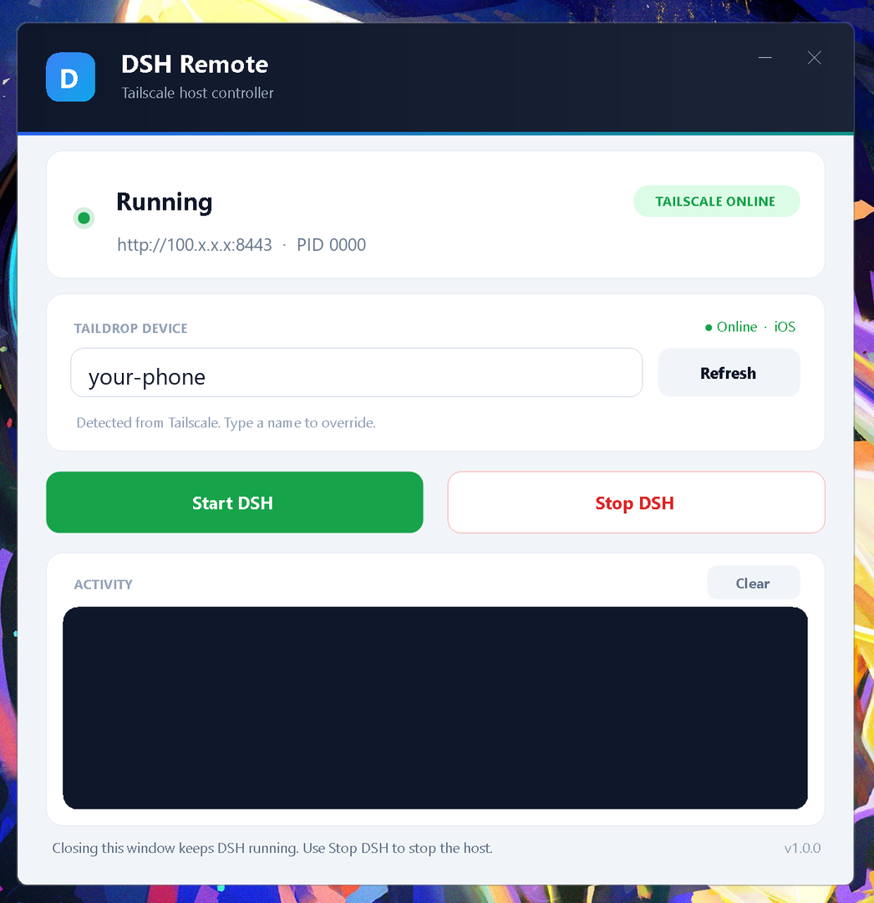

# DSH Remote

**Control the DeepSeek Harness (DSH) web host on your PC from your phone over Tailscale.**

DSH Remote is a small Windows app (WinForms, a single `.exe`) plus a set of
PowerShell scripts. It starts and stops the DSH web host, then delivers a secure
pairing link or QR code to a phone on your tailnet. The phone is only a remote
screen: every command still runs locally on the PC.

> English is the default documentation. [Đọc bản tiếng Việt](README.vi.md).



---

## Features

- **One-click Start / Stop** of the DSH web host.
- **Tailscale auto-discovery** via `tailscale status --json`: finds this PC's
  Tailscale IPv4 and suggests an online iPhone/iPad/Android peer
  (see [Limitations](#limitations--read-first)).
- **Pairing link delivery** by local QR code (generated with `segno`, never sent to
  a third-party QR service) or by Taildrop as a small HTML file.
- **Short-lived web sessions**: an overlay patch caps the login cookie at **1 day**
  instead of the upstream 30 days.
- **Stop = clean up**: stopping the host rotates the cookie-signing secret and
  deletes QR images, pairing HTML files and the saved URL. Use `keep` to preserve
  the current login.
- **No installer, no Visual Studio, no .NET SDK**: the build script uses the
  `csc.exe` that ships with .NET Framework 4.8.
- **Custom-drawn UI** with DPI-aware scaling and a single-instance guard.

---

## Limitations — read first

- **Tailscale is mandatory.** The host binds only to this PC's Tailscale IPv4
  (never `0.0.0.0` or your LAN IP), and the phone reaches it through the tailnet.
  Without Tailscale running and logged in, the GUI refuses to start the host and
  the scripts stop with an error. There is no LAN-only or public-internet mode
  (the only exception is `-ListenHost 127.0.0.1` for testing on the PC itself).
- **Device auto-detection only suggests mobile devices.** The Taildrop device box
  is pre-filled only with an **online peer that Tailscale reports as iOS or
  Android**: iPhone, iPad, Android phones and tablets. When a peer reports no OS,
  the name is checked for `iphone`, `ipad`, `android` or `phone`. Windows, macOS
  and Linux peers are never suggested.
  - You can still **type any Taildrop device name** by hand to override.
  - Leave the box empty to show the **QR on the PC** instead. Any device in the
    tailnet with a camera and a browser can scan it.
- **Windows only** for the PC side (WinForms + PowerShell + `netstat.exe`).
- **Requires DeepSeek Harness** on the PC; this app only drives `dsh web`.

---

## Requirements

| Requirement | Notes |
|---|---|
| **Windows 10 / 11** | x64 (ARM64 works under emulation). |
| **.NET Framework 4.8** | Required to build and run. Usually present on up-to-date Windows 10/11. |
| **PowerShell 5.1+** | Windows PowerShell is enough; PowerShell 7 (`pwsh`) also works. |
| **DeepSeek Harness (DSH)** | The app locates `DeepSeek Harness.exe` / `dsh.cmd` automatically, or you can set the paths in the settings file. |
| **Tailscale** | Installed and logged in on both the PC and the phone, in the same tailnet. |
| **Python 3 + `segno`** *(optional)* | For QR generation: `python -m pip install segno`. Without it, the URL is still printed and copied to the clipboard. |
| **Taildrop / Send Files** *(optional)* | Enable "Send Files" in the Tailscale admin console to use `-Taildrop`. |

The phone does **not** need DSH installed — only a browser and Tailscale.

No setup folder is needed on a new PC. The runtime folder
(`%USERPROFILE%\.dsh\remote` by default) is created automatically on first run.
If DSH has never been started on that PC, `stop` reports that there is no token to
rotate and carries on.

---

## Quick start (GUI)

1. Build the app (or use a release build):

   ```powershell
   cd winforms
   powershell.exe -NoProfile -ExecutionPolicy Bypass -File .\build.ps1
   ```

   Output: `..\DSH Remote.exe`.

2. Run `DSH Remote.exe` or double-click `Run-DSH-Remote.bat`.

3. Check that the status chip says **TAILSCALE ONLINE** and pick a Taildrop device
   (auto-detected, or type a name).

4. Click **Start DSH**. The app starts the host, shows the URL/PID, and opens the
   pairing QR (or sends the link through Taildrop).

5. On the phone: enable Tailscale, scan the QR / open the link, and log in once.
   The server sets a signed cookie valid for **1 day**, then redirects to the clean
   URL.

6. Click **Stop DSH** when done. This stops the host, rotates the token secret and
   removes QR/pairing files. Closing the window does **not** stop the host.

---

## Command line / scripts

`start-dsh-web.bat` and `stop-dsh-web.bat` are thin wrappers around the PowerShell
scripts and are the recommended entry points.

### Start

```bat
start-dsh-web.bat
start-dsh-web.bat -Taildrop your-phone
start-dsh-web.bat -ListenHost 127.0.0.1
start-dsh-web.bat -PublicUrl https://your-pc.your-tailnet.ts.net/ -TrustedHost your-pc.your-tailnet.ts.net
```

`start-dsh-web.ps1` parameters:

| Parameter | Default | Purpose |
|---|---|---|
| `-ListenHost` | `auto` | Bind address. `auto` uses the Tailscale IPv4. |
| `-Port` | `8443` | HTTP port. |
| `-Profile` | `web` | DSH profile for the web host. |
| `-DshExe` | auto | Path to `DeepSeek Harness.exe`. |
| `-DshCli` | auto | Path to `dsh.cmd`. |
| `-Taildrop` | empty | Send the link to this Taildrop device instead of showing the QR on the PC. |
| `-PublicUrl` | empty | Public URL when running behind `tailscale serve`. |
| `-TrustedHost` | empty | Extra trusted host name(s), repeatable. |
| `-NoQr` | off | Do not generate a QR image. |
| `-NoOpenQr` | off | Generate the QR but do not open it. |
| `-NoCookiePatch` | off | Skip the 1-day cookie overlay (back to the upstream 30 days). For diagnosis only. |
| `-DryRun` | off | Print the command that would run, without starting the host. |
| `-RuntimeDir` | auto | Folder for runtime files. See [Runtime folder](#runtime-folder). |

### Stop

```bat
stop-dsh-web.bat            :: stop + delete QR + rotate token (default)
stop-dsh-web.bat keep       :: stop, but keep the current login
stop-dsh-web.bat task       :: schedule the stop through Task Scheduler
stop-dsh-web.bat dry        :: show what would be stopped/deleted
```

`dsh-web-stop.ps1` parameters: `-Action` (`keep` / `task` / `dry`), `-Port`,
`-DelaySeconds`, `-ViaTask`, `-RotateToken`, `-KeepSessions`, `-DryRun`, `-RuntimeDir`.

To rotate the token, `stop` edits DSH's own credential file
`<DSH home>\.credentials.yaml` (`%DSH_HOME%` if set, otherwise
`%USERPROFILE%\.dsh`). It takes a temporary backup, removes it once the edit is
verified, and keeps it only if the edit fails and the original is restored.

### How pairing works

1. The start script verifies that the Tailscale IP exists on this machine.
2. It launches:
   `dsh --profile web --patch connection-1day.patch.yml --host <tailscale-ip> --port 8443 --no-open`
   as a hidden, independent process.
3. It waits for the `dsh web: http://...?token=...` line, saves the URL to
   `<runtime folder>\dsh-web.url.txt`, copies it to the clipboard, and
   creates `dsh-web-qr-<timestamp>.png` locally.
4. The phone opens the token URL once. The server sets a signed cookie with
   `Max-Age=86400` (1 day) and redirects to the clean URL.
5. After that, the phone can reopen `http://<tailscale-ip>:8443/` without the token
   until the cookie expires.
6. `stop` rotates the signing secret, so every old cookie becomes invalid.

---

## Configuration

The GUI stores its settings in
`<runtime folder>\gui-settings.ini`. A template is provided as
[`gui-settings.ini.example`](gui-settings.ini.example).

| Key | Default | Meaning |
|---|---|---|
| `Device` | empty | Taildrop device name used for the pairing link. |
| `LastAction` | empty | Last GUI action (`start` / `stop`). |
| `LastUpdated` | empty | Timestamp of the last action. |
| `DshExe` | auto | Explicit path to `DeepSeek Harness.exe`. |
| `DshCli` | auto | Explicit path to `dsh.cmd`. |
| `ListenHost` | `auto` | Bind address; `auto` = Tailscale IPv4. |
| `Port` | `8443` | Host port. |
| `Profile` | `web` | DSH profile. |

### Runtime folder

The first match wins (the GUI and both scripts use the same order):

1. `-RuntimeDir <path>` (scripts only; the GUI always passes its own folder).
2. The `DSH_REMOTE_DIR` environment variable.
3. **Portable mode:** a `data\` folder next to `DSH Remote.exe` (GUI) or next to
   the scripts (`.bat`). Create the folder to turn it on.
4. Default: `%USERPROFILE%\.dsh\remote` (outside OneDrive on purpose).

Relative paths are resolved against the exe/script folder. The start script
prints the folder in use and warns if it is inside OneDrive, Dropbox, Google
Drive or iCloud Drive. `data/` is in `.gitignore`. Still, do not use portable
mode inside a cloud-synced folder.

```
<runtime folder>\
├─ gui-settings.ini
├─ gui.log
├─ dsh-web.log
├─ dsh-web.err.log
├─ dsh-web.url.txt
└─ dsh-web-qr-<timestamp>.png
```

Do not commit or share these files: `dsh-web.url.txt` and the QR/link files contain
the pairing token.

---

## Security

- **The token URL is a remote-control credential.** Anyone who has it can run
  commands on the PC. Never paste it into chat, a screenshot, a commit or a ticket.
- The host binds **only** to the Tailscale IP, not `0.0.0.0`.
- Traffic is plain HTTP but travels inside Tailscale's WireGuard tunnel. For a
  proper HTTPS URL, run `tailscale serve --bg 8443` and start with
  `-PublicUrl https://<machine>.<tailnet>.ts.net/` + `-TrustedHost ...`.
- The web login cookie is capped at **1 day** by `connection-1day.patch.yml`.
- `stop` (default) rotates the signing secret and deletes QR/pairing artifacts.
- Keep runtime files outside cloud-synced folders.
- The start script copies the token URL to the clipboard. If Windows clipboard
  history **sync across devices** is on (Settings → System → Clipboard), the token
  may be uploaded to your Microsoft account. Turn sync off, or clear the clipboard
  after pairing.
- Every device in your tailnet can reach port 8443 (it still needs the token or a
  valid cookie). On a shared tailnet, restrict it with Tailscale ACLs.
- Optional hardening: allow port 8443 only from the Tailscale range
  `100.64.0.0/10` in Windows Firewall.

---

## Build from source

```powershell
cd winforms
powershell.exe -NoProfile -ExecutionPolicy Bypass -File .\build.ps1
```

- The build uses `C:\Windows\Microsoft.NET\Framework64\v4.0.30319\csc.exe`
  (with an x86 fallback).
- The source is **C# 5** — no string interpolation, `?.`, `nameof` or other
  C# 6+ syntax.
- If `DSH Remote.exe` is running, Windows locks it and the build writes
  `DSH Remote.new.exe` instead. Close the window and build again; do not delete a
  running host just to rebuild the GUI.
- To output somewhere else: `.\build.ps1 -OutFile <path>`.

---

## Repository layout

```
.
├─ README.md                  # English (default)
├─ README.vi.md               # Vietnamese
├─ AGENTS.md                  # contributor / agent conventions
├─ LICENSE                    # MIT
├─ .gitignore
├─ .gitattributes             # keeps CRLF for .bat files
├─ gui-settings.ini.example   # settings template (no secrets)
├─ connection-1day.patch.yml  # 1-day cookie overlay
├─ Run-DSH-Remote.bat         # launch the built exe
├─ start-dsh-web.bat          # start wrapper
├─ stop-dsh-web.bat           # stop wrapper
├─ dsh-web-start.ps1          # start host + QR/Taildrop
├─ dsh-web-stop.ps1           # stop + rotate + cleanup
├─ docs/
│  └─ ui-preview.png          # sanitized UI preview
└─ winforms/
   ├─ build.ps1
   ├─ app.manifest
   └─ *.cs                    # WinForms source
```

Build output (`DSH Remote.exe`), backups (`*.bak-*`), logs, QR images and personal
settings are ignored by `.gitignore`.

---

## Troubleshooting

**`build.ps1 cannot be loaded because running scripts is disabled`**
Use the per-process bypass:

```powershell
powershell.exe -NoProfile -ExecutionPolicy Bypass -File .\build.ps1
```

Do not change the machine-wide policy just to build. If you prefer to run
`.\build.ps1` directly, opt in explicitly with
`Set-ExecutionPolicy -Scope CurrentUser RemoteSigned`.

**Build produced `DSH Remote.new.exe`**
The old exe was still running. Close the DSH Remote window (the host keeps running),
then build again to replace `DSH Remote.exe`.

**Tailscale chip is offline / no IPv4**
Start Tailscale and log in on the PC. Check with `tailscale status` and
`tailscale ip -4`. The host refuses to bind to an address that is not present.

**Port 8443 is already in use**
Check with `netstat -ano | findstr :8443`, then stop the old host or choose another
port (`-Port` / `Port=` in settings).

**No QR image**
Install `segno`: `python -m pip install segno`. The URL is still printed and copied
to the clipboard, so you can send it manually.

**Taildrop delivery fails**
The phone must be online and "Send Files" must be enabled in the Tailscale admin
console. The script falls back to showing the QR on the PC.

**Logs**
`<runtime folder>\gui.log`, `dsh-web.log`, `dsh-web.err.log`,
`dsh-web-stop.log`.

**Running from an automation/agent sandbox**
Writes to `%USERPROFILE%\.dsh` and Taildrop's named pipe may be blocked. Run the
`.bat` files from Explorer or a normal terminal instead.

---

## Notes

- DSH Remote is an unofficial helper for DeepSeek Harness and is not affiliated
  with DeepSeek.
- The GUI and scripts were built for a single-user Windows PC; they are not a
  multi-tenant server.

---

## License

[MIT](LICENSE) © 2026 cuongphamthe185. The software is provided "as is", without
warranty of any kind. You control your own PC with it at your own risk.
