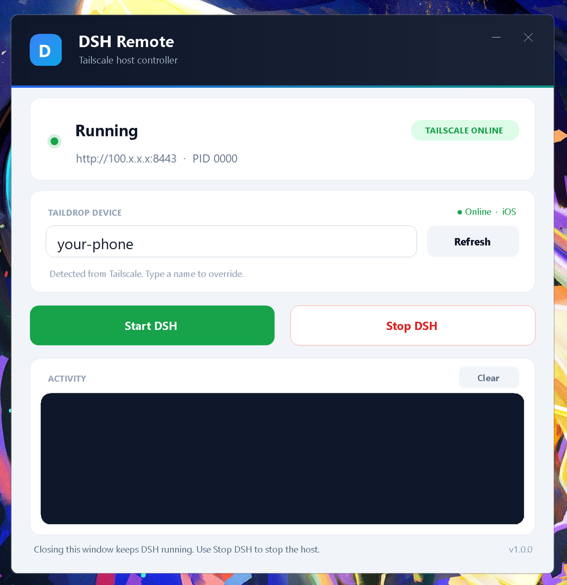

# DSH Remote

**Bật/tắt DSH web host trên PC và điều khiển từ điện thoại qua Tailscale.**

DSH Remote là một app Windows nhỏ (WinForms, đóng gói thành một file `.exe`) kèm
bộ script PowerShell. App khởi động/dừng DSH web host, sau đó gửi link ghép hoặc
mã QR cho điện thoại trong cùng tailnet. Điện thoại chỉ là màn hình điều khiển:
mọi lệnh vẫn chạy local trên PC.

> Bản tiếng Anh là mặc định: [Read in English](README.md).



---

## Tính năng

- **Bật / tắt host bằng một nút** trên giao diện.
- **Tự dò Tailscale** qua `tailscale status --json`: lấy IPv4 Tailscale của máy và
  gợi ý một thiết bị iPhone/iPad/Android đang online
  (xem [Giới hạn](#giới-hạn--đọc-trước)).
- **Gửi link ghép** bằng QR sinh local (dùng `segno`, không gửi token lên dịch vụ
  QR online) hoặc qua Taildrop dưới dạng file HTML nhỏ.
- **Phiên web ngắn**: overlay patch ép cookie đăng nhập còn **1 ngày** thay vì 30
  ngày mặc định của upstream.
- **Stop là dọn dẹp**: dừng host, xoay secret ký cookie, xoá ảnh QR / file HTML /
  file URL. Dùng `keep` nếu muốn giữ đăng nhập hiện tại.
- **Không cần installer, Visual Studio hay .NET SDK**: script build dùng `csc.exe`
  có sẵn trong .NET Framework 4.8.
- **UI tự vẽ**, tự scale theo DPI, chặn mở nhiều instance.

---

## Giới hạn — đọc trước

- **Bắt buộc có Tailscale.** Host chỉ lắng nghe trên IPv4 Tailscale của PC (không
  bao giờ `0.0.0.0` hay IP mạng LAN), và điện thoại truy cập qua tailnet. Nếu
  Tailscale chưa chạy hoặc chưa đăng nhập, GUI sẽ không cho bật host và script dừng
  kèm thông báo lỗi. Không có chế độ chỉ-LAN hay public internet (ngoại lệ duy nhất:
  `-ListenHost 127.0.0.1` để test ngay trên PC).
- **Tự nhận diện thiết bị chỉ gợi ý thiết bị di động.** Ô Taildrop device chỉ tự
  điền **thiết bị đang online mà Tailscale báo OS là iOS hoặc Android**: iPhone,
  iPad, điện thoại và tablet Android. Nếu thiết bị không báo OS, app xét tên có chứa
  `iphone`, `ipad`, `android` hoặc `phone`. Máy Windows, macOS, Linux không bao giờ
  được gợi ý.
  - Vẫn có thể **gõ tay tên thiết bị Taildrop bất kỳ** để thay thế.
  - Để trống ô này thì app **hiện QR trên PC**. Thiết bị nào trong tailnet có
    camera và trình duyệt cũng quét được.
- **Chỉ chạy trên Windows** ở phía PC (WinForms + PowerShell + `netstat.exe`).
- **Cần DeepSeek Harness** trên PC; app này chỉ điều khiển `dsh web`.

---

## Yêu cầu

| Thành phần | Ghi chú |
|---|---|
| **Windows 10 / 11** | x64 (ARM64 chạy qua emulation). |
| **.NET Framework 4.8** | Cần để build và chạy. Windows 10/11 đã cập nhật thường có sẵn. |
| **PowerShell 5.1+** | Windows PowerShell là đủ; PowerShell 7 (`pwsh`) cũng chạy được. |
| **DeepSeek Harness (DSH)** | App tự dò `DeepSeek Harness.exe` / `dsh.cmd`, hoặc khai báo trong file settings. |
| **Tailscale** | Cài và đăng nhập trên cả PC và điện thoại, cùng một tailnet. |
| **Python 3 + `segno`** *(tuỳ chọn)* | Để sinh QR: `python -m pip install segno`. Không có vẫn in và copy URL. |
| **Taildrop / Send Files** *(tuỳ chọn)* | Bật "Send Files" trong admin console Tailscale để dùng `-Taildrop`. |

Điện thoại **không cần** cài DSH — chỉ cần trình duyệt và Tailscale.

Máy mới không cần chuẩn bị thư mục nào. Thư mục runtime (mặc định
`%USERPROFILE%\.dsh\remote`) được tạo tự động ở lần chạy đầu. Nếu DSH chưa từng chạy
trên máy đó, `stop` chỉ báo không có token để xoay rồi chạy tiếp.

---

## Dùng nhanh (giao diện)

1. Build app (hoặc dùng bản release):

   ```powershell
   cd winforms
   powershell.exe -NoProfile -ExecutionPolicy Bypass -File .\build.ps1
   ```

   Kết quả: `..\DSH Remote.exe`.

2. Chạy `DSH Remote.exe` hoặc double-click `Run-DSH-Remote.bat`.

3. Kiểm tra chip trạng thái là **TAILSCALE ONLINE**, chọn thiết bị Taildrop
   (tự dò hoặc gõ tay).

4. Bấm **Start DSH**. App bật host, hiện URL/PID và mở QR ghép (hoặc gửi link qua
   Taildrop).

5. Trên điện thoại: bật Tailscale, quét QR / mở link, đăng nhập một lần. Server
   đặt cookie ký hạn **1 ngày** rồi chuyển về URL sạch.

6. Bấm **Stop DSH** khi xong. Thao tác này dừng host, xoay secret và xoá QR/file
   ghép. **Đóng cửa sổ không làm host dừng.**

---

## Dòng lệnh / script

`start-dsh-web.bat` và `stop-dsh-web.bat` là vỏ gọi PowerShell, là cách dùng
khuyến nghị.

### Bật

```bat
start-dsh-web.bat
start-dsh-web.bat -Taildrop your-phone
start-dsh-web.bat -ListenHost 127.0.0.1
start-dsh-web.bat -PublicUrl https://your-pc.your-tailnet.ts.net/ -TrustedHost your-pc.your-tailnet.ts.net
```

Tham số của `dsh-web-start.ps1`:

| Tham số | Mặc định | Ý nghĩa |
|---|---|---|
| `-ListenHost` | `auto` | Địa chỉ bind. `auto` = IPv4 Tailscale. |
| `-Port` | `8443` | Cổng HTTP. |
| `-Profile` | `web` | Profile DSH cho web host. |
| `-DshExe` | tự dò | Đường dẫn `DeepSeek Harness.exe`. |
| `-DshCli` | tự dò | Đường dẫn `dsh.cmd`. |
| `-Taildrop` | rỗng | Gửi link tới thiết bị Taildrop này thay vì hiện QR trên PC. |
| `-PublicUrl` | rỗng | URL public khi chạy sau `tailscale serve`. |
| `-TrustedHost` | rỗng | Thêm host tin cậy, có thể truyền nhiều lần. |
| `-NoQr` | tắt | Không sinh ảnh QR. |
| `-NoOpenQr` | tắt | Sinh QR nhưng không tự mở. |
| `-NoCookiePatch` | tắt | Bỏ overlay cookie 1 ngày (quay lại 30 ngày). Chỉ dùng để chẩn đoán. |
| `-DryRun` | tắt | In lệnh sẽ chạy, không bật host. |
| `-RuntimeDir` | tự chọn | Thư mục chứa file runtime. Xem [Thư mục runtime](#thư-mục-runtime). |

### Tắt

```bat
stop-dsh-web.bat            :: tắt + xoá QR + xoay token (mặc định)
stop-dsh-web.bat keep       :: tắt nhưng giữ đăng nhập hiện tại
stop-dsh-web.bat task       :: hẹn tắt qua Task Scheduler
stop-dsh-web.bat dry        :: chỉ xem sẽ tắt/xoá gì
```

Tham số `dsh-web-stop.ps1`: `-Action` (`keep` / `task` / `dry`), `-Port`,
`-DelaySeconds`, `-ViaTask`, `-RotateToken`, `-KeepSessions`, `-DryRun`, `-RuntimeDir`.

Để xoay token, `stop` sửa file credential của chính DSH:
`<DSH home>\.credentials.yaml` (`%DSH_HOME%` nếu có, mặc định
`%USERPROFILE%\.dsh`). Script tạo backup tạm, xoá ngay khi sửa xong và kiểm tra
thành công; chỉ giữ lại khi sửa lỗi và đã khôi phục file gốc.

### Cách ghép hoạt động

1. Script start kiểm tra IP Tailscale có thật trên máy.
2. Chạy:
   `dsh --profile web --patch connection-1day.patch.yml --host <tailscale-ip> --port 8443 --no-open`
   dưới dạng tiến trình ẩn, độc lập.
3. Chờ dòng `dsh web: http://...?token=...`, lưu URL vào
   `<thư mục runtime>\dsh-web.url.txt`, copy vào clipboard và sinh
   `dsh-web-qr-<timestamp>.png` local.
4. Điện thoại mở URL có token một lần. Server đặt cookie ký `Max-Age=86400`
   (1 ngày) rồi chuyển về URL sạch.
5. Sau đó điện thoại mở lại `http://<tailscale-ip>:8443/` không cần token cho tới
   khi cookie hết hạn.
6. `stop` xoay secret ký cookie → mọi cookie cũ vô hiệu.

---

## Cấu hình

GUI lưu settings ở `<thư mục runtime>\gui-settings.ini`. File mẫu:
[`gui-settings.ini.example`](gui-settings.ini.example).

| Key | Mặc định | Ý nghĩa |
|---|---|---|
| `Device` | rỗng | Tên thiết bị Taildrop dùng để gửi link. |
| `LastAction` | rỗng | Hành động gần nhất (`start` / `stop`). |
| `LastUpdated` | rỗng | Thời điểm hành động gần nhất. |
| `DshExe` | tự dò | Đường dẫn `DeepSeek Harness.exe`. |
| `DshCli` | tự dò | Đường dẫn `dsh.cmd`. |
| `ListenHost` | `auto` | Địa chỉ bind; `auto` = IPv4 Tailscale. |
| `Port` | `8443` | Cổng host. |
| `Profile` | `web` | Profile DSH. |

### Thư mục runtime

Lấy theo thứ tự, gặp cái nào trước dùng cái đó (GUI và 2 script dùng chung thứ tự):

1. `-RuntimeDir <đường dẫn>` (chỉ script; GUI luôn tự truyền thư mục của nó).
2. Biến môi trường `DSH_REMOTE_DIR`.
3. **Portable mode:** thư mục `data\` cạnh `DSH Remote.exe` (GUI) hoặc cạnh script
   (`.bat`). Tạo thư mục này là bật.
4. Mặc định: `%USERPROFILE%\.dsh\remote` (cố ý để ngoài OneDrive).

Đường dẫn tương đối tính từ thư mục exe/script. Script start in ra thư mục đang
dùng và cảnh báo nếu nằm trong OneDrive, Dropbox, Google Drive hoặc iCloud Drive.
`data/` đã có trong `.gitignore`, nhưng đừng bật portable mode trong thư mục đồng
bộ cloud.

```
<thư mục runtime>\
├─ gui-settings.ini
├─ gui.log
├─ dsh-web.log
├─ dsh-web.err.log
├─ dsh-web.url.txt
└─ dsh-web-qr-<timestamp>.png
```

Không commit/chia sẻ các file này: `dsh-web.url.txt` và file QR/link chứa token
ghép.

---

## Bảo mật

- **URL có token = quyền điều khiển máy.** Ai có URL đó có thể chạy lệnh trên PC.
  Không dán vào chat, ảnh chụp màn hình, commit hay ticket.
- Host chỉ bind vào **IP Tailscale**, không bind `0.0.0.0`.
- HTTP thuần nhưng nằm trong tunnel WireGuard của Tailscale. Muốn HTTPS thật, chạy
  `tailscale serve --bg 8443` rồi bật với
  `-PublicUrl https://<machine>.<tailnet>.ts.net/` + `-TrustedHost ...`.
- Cookie đăng nhập web bị ép còn **1 ngày** bởi `connection-1day.patch.yml`.
- `stop` (mặc định) xoay secret ký và xoá QR/file ghép.
- Giữ file runtime ngoài thư mục đồng bộ cloud.
- Script start copy URL có token vào clipboard. Nếu bật **đồng bộ lịch sử clipboard
  giữa các thiết bị** của Windows (Settings → System → Clipboard), token có thể bị
  upload lên tài khoản Microsoft. Hãy tắt đồng bộ, hoặc xoá clipboard sau khi ghép.
- Mọi thiết bị trong tailnet đều truy cập được cổng 8443 (vẫn cần token hoặc cookie
  hợp lệ). Nếu tailnet dùng chung với người khác, hãy giới hạn bằng Tailscale ACL.
- Siết thêm (tuỳ chọn): chỉ mở cổng 8443 cho dải `100.64.0.0/10` trong Windows
  Firewall.

---

## Build từ source

```powershell
cd winforms
powershell.exe -NoProfile -ExecutionPolicy Bypass -File .\build.ps1
```

- Build dùng `C:\Windows\Microsoft.NET\Framework64\v4.0.30319\csc.exe`
  (có fallback x86).
- Source là **C# 5** — không dùng string interpolation, `?.`, `nameof` hay cú pháp
  C# 6+.
- Nếu `DSH Remote.exe` đang chạy, Windows khoá file và build ghi ra
  `DSH Remote.new.exe`. Đóng cửa sổ rồi build lại; đừng tắt host chỉ để build GUI.
- Xuất ra chỗ khác: `.\build.ps1 -OutFile <path>`.

---

## Cấu trúc repo

```
.
├─ README.md                  # tiếng Anh (mặc định)
├─ README.vi.md               # tiếng Việt
├─ AGENTS.md                  # quy ước cho contributor / agent
├─ LICENSE                    # MIT
├─ .gitignore
├─ .gitattributes             # giữ CRLF cho file .bat
├─ gui-settings.ini.example   # mẫu settings (không có secret)
├─ connection-1day.patch.yml  # overlay cookie 1 ngày
├─ Run-DSH-Remote.bat         # chạy exe đã build
├─ start-dsh-web.bat          # vỏ lệnh bật
├─ stop-dsh-web.bat           # vỏ lệnh tắt
├─ dsh-web-start.ps1          # bật host + QR/Taildrop
├─ dsh-web-stop.ps1           # tắt + xoay token + dọn dẹp
├─ docs/
│  └─ ui-preview.png          # ảnh giao diện đã che dữ liệu
└─ winforms/
   ├─ build.ps1
   ├─ app.manifest
   └─ *.cs                    # source WinForms
```

Build output (`DSH Remote.exe`), backup (`*.bak-*`), log, ảnh QR và settings cá
nhân đều bị `.gitignore` bỏ qua.

---

## Xử lý sự cố

**`build.ps1 cannot be loaded because running scripts is disabled`**
Dùng bypass cho từng tiến trình:

```powershell
powershell.exe -NoProfile -ExecutionPolicy Bypass -File .\build.ps1
```

Đừng đổi policy toàn máy chỉ để build. Nếu muốn gõ thẳng `.\build.ps1`, tự bật
bằng `Set-ExecutionPolicy -Scope CurrentUser RemoteSigned`.

**Build ra `DSH Remote.new.exe`**
Exe cũ vẫn đang chạy. Đóng cửa sổ DSH Remote (host vẫn chạy), rồi build lại để
thay `DSH Remote.exe`.

**Chip Tailscale offline / không có IPv4**
Bật Tailscale và đăng nhập trên PC. Kiểm tra `tailscale status` và
`tailscale ip -4`. Host từ chối bind vào địa chỉ không có trên máy.

**Cổng 8443 đang bị chiếm**
Kiểm tra `netstat -ano | findstr :8443`, tắt host cũ hoặc đổi cổng
(`-Port` / `Port=` trong settings).

**Không sinh được QR**
Cài `segno`: `python -m pip install segno`. URL vẫn được in và copy vào clipboard
nên có thể gửi tay.

**Gửi Taildrop lỗi**
Điện thoại phải online và "Send Files" phải bật trong admin console Tailscale.
Script sẽ tự quay lại hiện QR trên PC.

**Log**
`<thư mục runtime>\gui.log`, `dsh-web.log`, `dsh-web.err.log`,
`dsh-web-stop.log`.

**Chạy từ sandbox của agent/automation**
Ghi vào `%USERPROFILE%\.dsh` và named pipe của Taildrop có thể bị chặn. Hãy chạy
file `.bat` từ Explorer hoặc terminal bình thường.

---

## Ghi chú

- DSH Remote là công cụ không chính thức cho DeepSeek Harness, không liên kết với
  DeepSeek.
- GUI và script được thiết kế cho PC Windows một người dùng; không phải server
  multi-tenant.

---

## Giấy phép

[MIT](LICENSE) © 2026 cuongphamthe185. Phần mềm được cung cấp "nguyên trạng"
(as is), không kèm bất kỳ bảo đảm nào. Bạn tự chịu rủi ro khi dùng nó để điều khiển
PC của mình.
